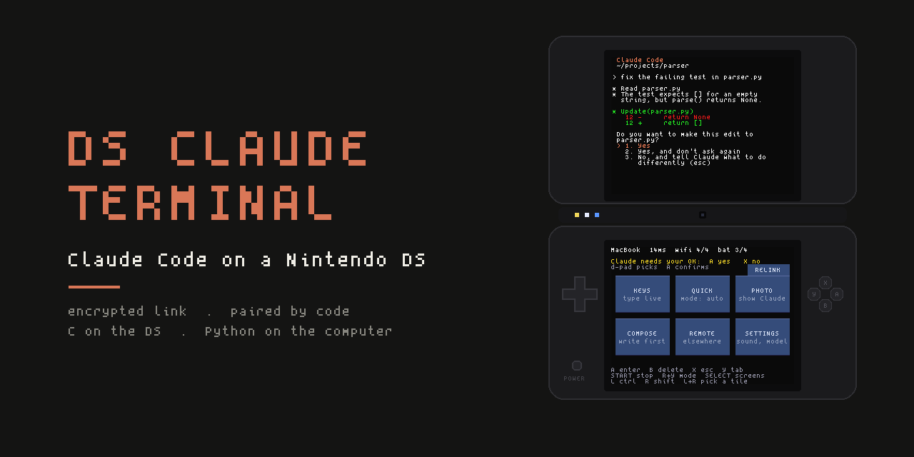
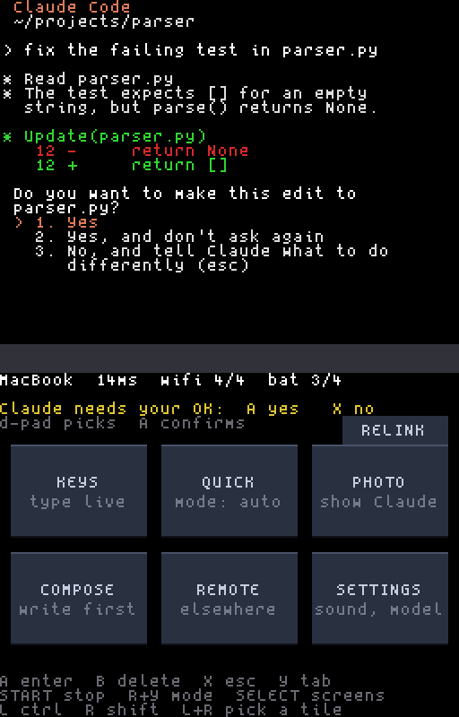
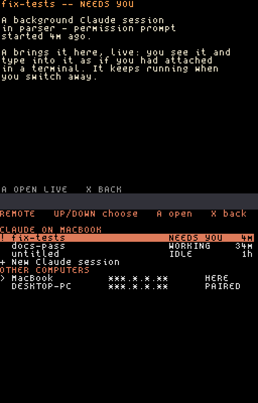
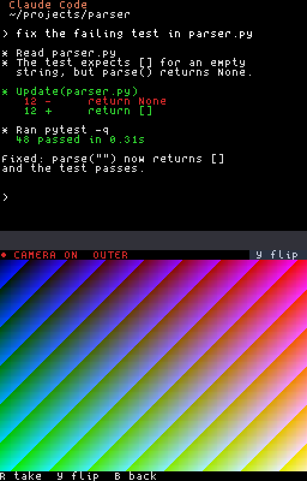
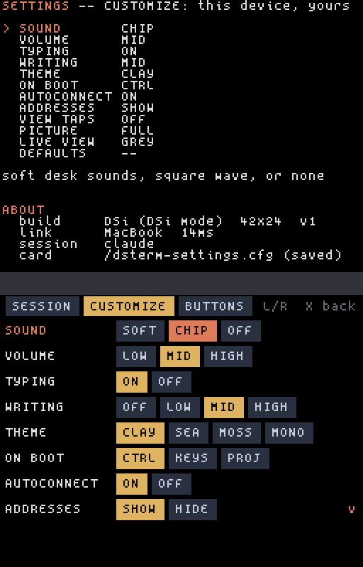
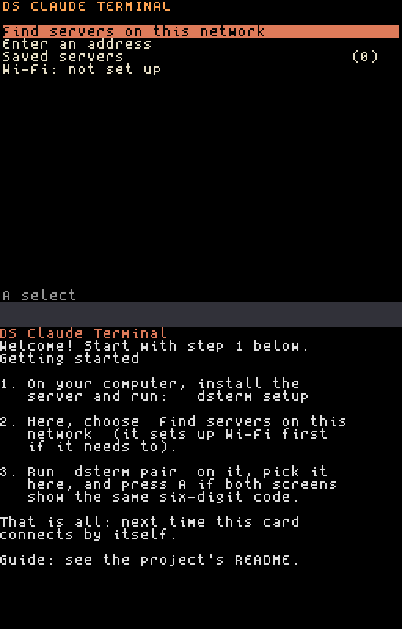

<div align="center">



<br><br>

Your DS becomes a wireless screen and keyboard for the Claude Code session on
your computer. Read what Claude is doing, approve its edits with a button, and
type prompts on the touch screen, from the couch.

<br>


-3d3d3a?style=flat-square)


[**Setup**](#setup) · [**Pairing**](#pairing) · [Using it](docs/USING.md) · [Under the hood](#under-the-hood) · [Troubleshooting](TROUBLESHOOTING.md)

</div>

<br>

Your code and Claude Code itself stay on your computer. The DS only shows the
screen and sends keys, everything between them is encrypted, and nothing the
DS sends can run a command or read a file.

## What it does

| Feature | What it does |
|---|---|
| **Your live session** | The top screen is the Claude Code terminal, 42×24, updated as it changes |
| **Approvals on a button** | The DS tells you, in words and with a sound, when Claude is working, done, or needs your OK. **A** says yes, **X** says no |
| **QUICK** | Claude's mode on one tile, plus rewind, the diff, slash commands and your recent prompts |
| **REMOTE** | Every Claude session on the computer (which are working, which need you), and your other computers |
| **PHOTO** | On a DSi or 3DS, take a picture and it lands on the computer with its path in your prompt |
| **`dsterm view`** | Both DS screens on your computer, pixel for pixel like an emulator. Type and click from there |
| **Comfortable typing** | A live touch keyboard, a composer for longer prompts, snippets, and your own command buttons |
| **Sounds** | The classic chip voice, a soft desk set, or your own WAV files. Or silence |
| **Yours to set up** | Accent colour, button mapping, start screen, all on the DS's Settings page |
| **Always reconnects** | Sleep, Wi-Fi drops, server restarts: the DS finds its way back by itself |
| **Encrypted** | Pairing by a six-digit code, then every frame encrypted and signed |
| **Demo mode** | One setting stars out every IP address on screen, for streams and photos |

<p align="center">
  
  &nbsp;
  
  &nbsp;
  
  &nbsp;
  
</p>

## Supported consoles

| Console | Runs the app with | Wi-Fi |
|---|---|---|
| **DSi, DSi XL** | Unlaunch or TWiLight Menu++ | WPA2 or open, 2.4 GHz |
| **3DS, 3DS XL, 2DS, New 3DS, New 3DS XL, New 2DS XL** | TWiLight Menu++ | WPA2 or open, 2.4 GHz |
| **DS, DS Lite** | A flashcart (R4, Acekard, DSTT, ...) | Open networks only (a hardware limit) |

One file runs on all of them. It's tested on a DSi; reports from the others
are very welcome ([status](#status)).

---

## Setup

Four steps, once. After that you just switch the DS on.

| | Step | Time |
|:-:|---|---|
| **1** | [Get the console ready](#1-get-the-console-ready) | 0 min if it already runs homebrew, an evening if not |
| **2** | [Put the app on the SD card](#2-put-the-app-on-the-sd-card) | 2 min |
| **3** | [Install the server on your computer](#3-install-the-server-on-your-computer) | 5 min |
| **4** | [Pair the DS with your computer](#pairing) | 1 min |

**You need:** a DS-family console, its SD card, a Mac / Linux PC / Windows
10-11 PC, [Claude Code](https://claude.com/claude-code) installed and logged
in on it, and 2.4 GHz Wi-Fi that both can join.

### 1. Get the console ready

A console from the shop only runs cartridges. To run this app it needs a
one-time softmod, or a flashcart for a DS or DS Lite.

| Console | Do this |
|---|---|
| DSi, DSi XL | Install Unlaunch: <https://dsi.cfw.guide> |
| 3DS, 2DS (any) | Custom firmware, then TWiLight Menu++: <https://3ds.hacks.guide> |
| DS, DS Lite | A Slot-1 flashcart that runs homebrew |

Already done this for other homebrew? Skip ahead. More on each model:
[docs/HARDWARE.md](docs/HARDWARE.md).

> [!TIP]
> **You should see:** a menu (TWiLight Menu++, Unlaunch, or your flashcart's)
> listing the files on the SD card.

### 2. Put the app on the SD card

1. Download **`dsterm-<version>.zip`** and
   **`ds_claude_terminal-<version>-py3-none-any.whl`** from this repository's
   **Releases** page.
2. Unzip the zip. Inside are **`dsterm.nds`** and a folder called **`dsterm`**.
3. Copy **both** to the top level of the SD card, not inside another folder.
4. Put the card back in the console.

> [!TIP]
> **You should see:** **DS Claude Terminal** in the console's menu.

### 3. Install the server on your computer

The server runs Claude Code on your computer and sends it to the DS. You
install it once; it keeps running in the background, and starts again after
a restart.

<details open>
<summary><b>Mac</b></summary>

<br>

Install [Homebrew](https://brew.sh) if you don't have it, then in Terminal:

```sh
brew install tmux pipx
pipx ensurepath
```

**Close Terminal and open a new one**, then, in the folder with the `.whl`:

```sh
pipx install ./ds_claude_terminal-*.whl
dsterm setup
```

The first time the server starts, macOS may ask whether Python may accept
incoming connections. Click **Allow**, or the DS can't reach it.

</details>

<details>
<summary><b>Linux</b></summary>

<br>

Debian and Ubuntu shown; use your distribution's packages elsewhere.

```sh
sudo apt install tmux pipx
pipx ensurepath
```

**Close the terminal and open a new one**, then, in the folder with the
`.whl`:

```sh
pipx install ./ds_claude_terminal-*.whl
dsterm setup
```

It needs Python 3.11 or newer. Ubuntu 24.04 has it. On 22.04, run
`sudo apt install python3.11` first and add `--python python3.11` to the
`pipx install` line.

</details>

<details>
<summary><b>Windows</b> (WSL2)</summary>

<br>

1. Install [WSL2 with Ubuntu](https://learn.microsoft.com/windows/wsl/install)
   if you haven't.
2. In the **Ubuntu** window, follow the **Linux** steps above.
3. Still in Ubuntu, let the DS through Windows' firewall (it asks first):

   ```sh
   dsterm wsl-setup
   ```

4. **Keep WSL running.** Windows shuts WSL down a few seconds after the last
   Ubuntu window closes, and the server would go with it. In **PowerShell**,
   run `notepad $env:USERPROFILE\.wslconfig`, put this in the file and save:

   ```ini
   [general]
   instanceIdleTimeout=-1

   [wsl2]
   vmIdleTimeout=-1
   ```

   Then run `wsl --shutdown` in PowerShell and open Ubuntu again.
5. *Optional:* to start WSL by itself when you sign in to Windows, see
   [docs/GETTING_STARTED.md](docs/GETTING_STARTED.md#start-wsl-when-you-sign-in-windows).

</details>

**Check it** on any computer:

```sh
dsterm doctor
```

> [!TIP]
> **You should see:** a list of `[ ok ]` lines. Any `[warn]` or `[FAIL]` line
> says what to do; [TROUBLESHOOTING.md](TROUBLESHOOTING.md) explains each one.

Claude Code starts in your home folder. To start it in a project instead:
`dsterm install-service --cwd ~/projects/my-app`.

### Pairing

Pairing is a one-time introduction, like pairing headphones over Bluetooth.
The DS and your computer check that they're really talking to each other and
agree on a key. **You don't type a password.** You just check that both
screens show the same six-digit code. From then on the connection is
encrypted, and nobody else on your network can read it or type into it.

<table>
<tr>
<td width="62%" valign="top">

#### A. Over Wi-Fi (the usual way)

1. **On the computer**, run `dsterm pair`. Pairing stays open for two
   minutes.
2. **On the DS**, start **DS Claude Terminal** and choose **Find servers on
   this network**.
3. **First time only:** pick your Wi-Fi network and type its password on the
   touch keyboard.
4. **Pick your computer** from the list (it's marked as open for pairing),
   then **Pair**.
5. **Compare the codes.** Both screens show six digits, like `482 913`.
   - **The same?** Press **A** on the DS, and type `y` on the computer.
   - **Different?** Press **B**. Something else answered; nothing is saved.
     Run `dsterm pair` and try again.

</td>
<td width="38%" valign="top" align="center">



<sub>The first start: the menu on top, a short guide below.</sub>

</td>
</tr>
</table>

> [!TIP]
> **You should see:** "Paired" on the DS, then Claude Code on the top screen
> and the Control screen below, with your computer's name at the top and a
> short chime.

#### B. From the computer, with the SD card

Rather not type a password on the DS? With the card in your computer, one
command copies the app, writes your Wi-Fi details and pairs it. Put the card
back in the DS and it connects on its own.

```sh
dsterm card /Volumes/SDCARD --rom dsterm.nds --wifi --pair
```

Use your card's path: `/Volumes/NAME` on a Mac, `/media/you/NAME` on Linux,
`/mnt/d` for drive D: in WSL. It checks everything it writes, never deletes
anything already on the card, and ejects it when done.

#### From now on

- **Switch the DS on** and it counts down from three and connects by itself.
  Press any button during the countdown for the menu instead.
- **If the connection drops** (the DS slept, the Wi-Fi blinked, the server
  restarted), it reconnects by itself. You never pair again.
- **Another computer?** Run `dsterm pair` there, press a button during the
  DS's countdown, and pair the same way. Switch between them in **REMOTE**.

### Try it

1. Press **KEYS**, type `hello` on the touch keyboard, and press **A**
   (Enter). Claude answers on the top screen.
2. Ask Claude to change a small file. When it asks to edit, the DS turns
   yellow: **"Claude needs your OK: A yes X no"**. Press **A**.
3. Press **X** to get back to the Control screen from anywhere.

[docs/USING.md](docs/USING.md) is the tour of everything else. To update,
install from source, or uninstall, see
[docs/GETTING_STARTED.md](docs/GETTING_STARTED.md).

---

## Under the hood

Two programs and the protocol between them, built for a 2004 handheld with a
67 MHz ARM9 and 4 MB of RAM.

- **A homebrew DS client in C** ([BlocksDS](https://blocksds.skylyrac.net),
  no OS): its own Wi-Fi setup, discovery and pairing menus, a bitmap
  terminal renderer, a touch keyboard, a sound mixer, and a camera pipeline
  that sends pictures over Wi-Fi.
- **A Python server** that runs Claude Code in tmux, emulates the terminal
  with [pyte](https://github.com/selectel/pyte), and streams only the cells
  that changed. Every message fits a single 536-byte TCP segment, the DS's
  limit, and the terminal emulator works to a time budget so no program's
  output can stall the link.
- **Cryptography written twice and checked against itself.** X25519 pairing
  with numeric comparison, then ChaCha20 and HMAC-SHA256 on every frame,
  implemented in both C and Python, pinned to the RFC test vectors and
  cross-checked byte for byte ([how it works](docs/SEAL.md)).
- **Tested like it matters.** About 1,200 Python tests, tens of thousands of
  C checks under AddressSanitizer and UBSan at two screen sizes, seeded
  fuzzing of every parser that reads outside bytes, CI on every push, and
  latency measured under load ([numbers](docs/PERFORMANCE.md)).

[ARCHITECTURE.md](docs/ARCHITECTURE.md) walks through every part.

## Guides

| Guide | For |
|---|---|
| [Using it](docs/USING.md) | Every screen and button, approvals, QUICK, REMOTE, the camera, `dsterm view` |
| [Your console](docs/HARDWARE.md) | Each DS model, the SD card, and the network |
| [Customizing](docs/CUSTOMIZING.md) | Your own sounds, buttons, snippets and settings, and changing the code |
| [Updating, from source, uninstalling](docs/GETTING_STARTED.md) | Everything after the first setup |
| [Troubleshooting](TROUBLESHOOTING.md) | `dsterm doctor`, and what each message on the DS means |
| [Performance](docs/PERFORMANCE.md) | What the server costs and how fast it answers, measured |
| [How it works](docs/ARCHITECTURE.md) | Every part of the repository and how they fit together |
| [Protocol](docs/PROTOCOL.md) and [encryption](docs/SEAL.md) | The wire format, for anyone writing another client or server |
| [Security](SECURITY.md) | The threat model, and how to report a problem |
| [Contributing](CONTRIBUTING.md) | Building, testing, and the rules the code keeps |

## Security, briefly

- **Pairing never sends a key.** The DS and the computer run an X25519
  exchange and you confirm the same code on both screens, which shuts out
  anyone in the middle. Each DS gets its own key; `dsterm devices forget`
  revokes one.
- **Every frame is encrypted and signed.** Nobody on your network can read
  your session or what you type, and a message that was forged, replayed or
  altered ends the connection instead of reaching it.
- **The DS can only do what a keyboard can.** Text pushed to it (snippets,
  the clipboard, project buttons) is shown in full and needs a second press
  before it's typed. GOD MODE, off until you turn it on and shown in red,
  lets project buttons skip that press.
- **What still shows on the network** is that a DS is talking to your
  computer, and when you type, but not what.

> [!WARNING]
> **Never expose the server's port to the internet.** To use it away from
> home, use a VPN that ends on your home network.

[SECURITY.md](SECURITY.md) has the full model.

## Status

Tested end to end on a DSi: Wi-Fi, discovery, pairing, the encrypted link, a
live Claude Code session, the buttons and touch keyboard, the camera, and
reconnecting after the console sleeps. The DS, DS Lite and 3DS family run the
same file, and their Wi-Fi follows the BlocksDS and TWiLight Menu++
documentation, but they haven't been tried on hardware yet. If you have one,
an **Install report** issue helps the next person most.

## Credits

Made by LC. MIT license; see [LICENSE](LICENSE). Built with
[BlocksDS](https://blocksds.skylyrac.net) and [pyte](https://github.com/selectel/pyte);
the sound set was generated with ElevenLabs and arranged for the DS.
Third-party notices are in [THIRD_PARTY_NOTICES.md](THIRD_PARTY_NOTICES.md).

<sub>Not affiliated with Nintendo or Anthropic.</sub>
