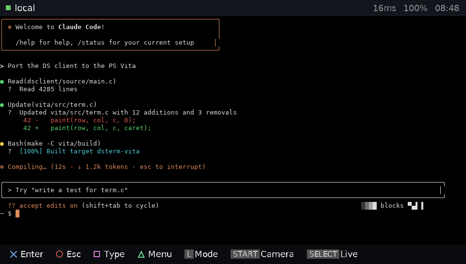
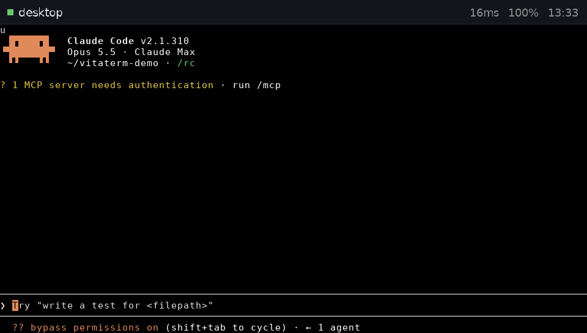
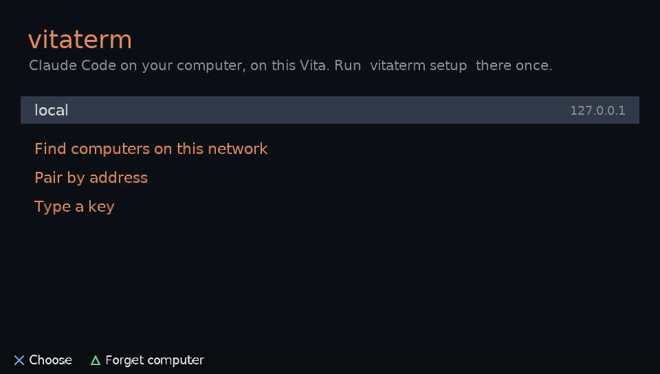
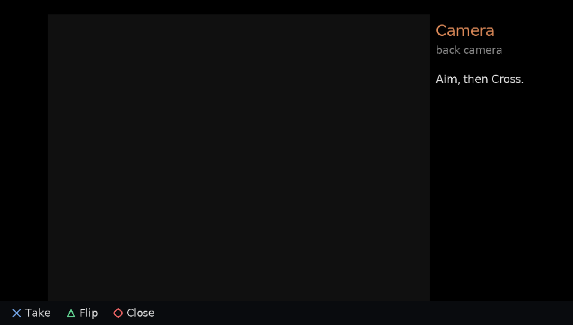

# vitaterm

**Claude Code on your PS Vita.** The Vita becomes a wireless screen and
controller for the Claude Code session running on your computer: read what
Claude is doing, approve its edits with Cross, type prompts on the Vita's
keyboard, and send it pictures from the Vita's camera.

Your code and Claude Code stay on your computer. The Vita only shows the
screen and sends keys, and everything between the two is encrypted.

<p>


</p>
<p>


</p>

<sub>Screenshots from the Vita3K emulator, connected to a real `vitaterm serve` running Claude Code.</sub>

> [!NOTE]
> This is a fork of [logancarrillo/ds-claude-terminal](https://github.com/logancarrillo/ds-claude-terminal),
> which does the same for the Nintendo DS. The Vita app is new (`vita/`); the
> server and the protocol are that project's, used as they are. The DS
> version's own README is [README-DS.md](README-DS.md).

## Features

- **Your live session**, 96×28 in a font made for the Vita's screen, accents included. A bar on top says what
  Claude is doing (working, needs your OK, asking you), plus the round trip,
  the battery and the time.
- **Approvals on a button.** Cross answers Claude's question, Circle stops it,
  the d-pad picks an option.
- **Typing** with the Vita's own keyboard, accents included.
- **Menu (Triangle):** every Claude Code session on the computer (switch to
  one, or start a new one), the slash commands (yours too), snippets, the keys
  the Vita has no button for (Ctrl+C, Esc Esc, Tab...), the camera and sound.
- **Camera:** take a picture with either camera and it lands on the computer,
  with its path in your next prompt.
- **Read back:** scroll through everything the session printed with a stick or
  a finger; Select jumps back to now.
- **Sounds** when Claude finishes or needs you.
- **Finds your computer** on the network, and pairs by comparing a six-digit
  code on both screens: no key typed, nothing secret sent.

## Setup

**You need:** a PS Vita or PS TV that runs homebrew (HENkaku/Ensō:
<https://vita.hacks.guide>), a Mac or Linux computer (Windows through WSL2)
with [Claude Code](https://claude.com/claude-code) installed and logged in,
and both on the same Wi-Fi.

### 1. The server, on your computer

It needs `tmux`, `pipx` and Python 3.11 or newer.

```sh
# macOS:          brew install tmux pipx
# Debian/Ubuntu:  sudo apt install tmux pipx
pipx ensurepath
```

Open a new terminal, then:

```sh
pipx install git+https://github.com/jmverges/vitaterm
vitaterm setup
```

`vitaterm setup` installs the server as a background service that starts by
itself. `vitaterm doctor` checks everything and says how to fix what isn't
right. On Windows, follow the WSL2 steps in
[README-DS.md](README-DS.md#3-install-the-server-on-your-computer) with
`vitaterm` in place of `dsterm`.

### 2. The app, on the Vita

Install `vitaterm.vpk` from this repository's **Releases** with VitaShell.

### 3. Pair

1. On the Vita, open **vitaterm** and choose **Find computers on this
   network**, then your computer.
2. On the computer, run `vitaterm pair`.
3. Check that both screens show the same six digits: Cross on the Vita, `y`
   on the computer.

From then on the Vita connects to it by itself when the app opens.

## Buttons

| Button | Does |
| --- | --- |
| Cross | Enter (answers Claude's question when one is open) |
| Circle | Esc (stops Claude) |
| Square | The keyboard: what you type is sent, then Enter |
| Triangle | The menu |
| D-pad | Arrow keys |
| L | Shift+Tab (Claude's mode) |
| R | Backspace (hold to repeat) |
| Sticks, or a finger on the screen | Scroll back through the session |
| Select | Back to now |
| Start | Camera |
| Select held | Show the buttons |

## Commands on the computer

| Command | Does |
| --- | --- |
| `vitaterm setup` | Install the background service (once) |
| `vitaterm pair` | Pair a Vita |
| `vitaterm devices` | The consoles paired with this computer |
| `vitaterm doctor` | Check everything |
| `vitaterm start` / `stop` / `restart` / `status` / `logs` | The service |
| `vitaterm serve` | Run the server in this terminal instead |
| `vitaterm attach` | Open the Claude session in this terminal |

`vitaterm` is the DS project's `dsterm` with the Vita's screen size: some of
its messages still say `dsterm`, and they mean the same program. Its settings
are in `~/.config/ds-claude-terminal/` (`serve.conf` sets the server's
options).

## On the Vita

Paired computers and settings live in `ux0:data/vitaterm`. Snippets can go
in `ux0:data/vitaterm/snippets.txt`, or the computer sends its own.

## Status

Early. Running on a PS Vita 1000: pairing by code, the encrypted
link, the terminal, typing and approvals work on real hardware. The camera
has been tested end to end in the Vita3K emulator.

## Building

See [vita/README.md](vita/README.md).

## License

MIT, like the project it is forked from: [LICENSE](LICENSE).
